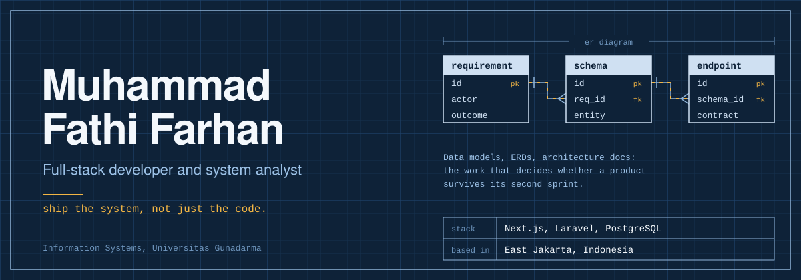
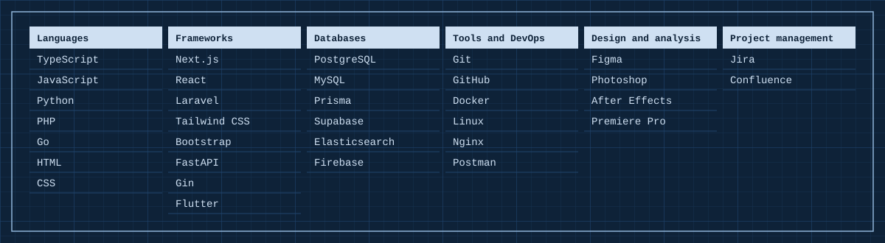

  

I build full-stack web systems with a focus on translating real business requirements into working software. Lately I'm into the *unsexy* parts of engineering: data modeling, ERDs, architecture docs. The work that decides whether a product survives its second sprint.

| | |
| :-- | :-- |
| **Based in** | East Jakarta, Indonesia 🇮🇩 |
| **Studying** | Information Systems at Universitas Gunadarma |
| **Building** | Next.js apps, Laravel APIs, PostgreSQL schemas |
| **Exploring** | System design, requirements engineering, clean architecture |

## Stack

  

## Activity

  <picture>
    <source media="(prefers-color-scheme: dark)" srcset="https://github-profile-summary-cards.vercel.app/api/cards/stats?username=Fathi-Farhan&theme=github_dark">
    
  </picture>
  <picture>
    <source media="(prefers-color-scheme: dark)" srcset="https://github-profile-summary-cards.vercel.app/api/cards/most-commit-language?username=Fathi-Farhan&theme=github_dark">
    
  </picture>

<picture>
  <source media="(prefers-color-scheme: dark)" srcset="https://raw.githubusercontent.com/Fathi-Farhan/Fathi-Farhan/output/snake-dark.svg" />
  <source media="(prefers-color-scheme: light)" srcset="https://raw.githubusercontent.com/Fathi-Farhan/Fathi-Farhan/output/snake.svg" />
  
</picture>

## Contact

[LinkedIn](https://bit.ly/LinkedIn-FathiFarhan) · [Portfolio](https://bit.ly/Portfolio-FathiFarhan-October2025) · [Email](mailto:fthfarhan12@gmail.com) · [Instagram](https://instagram.com/farhan.muhammadz)
